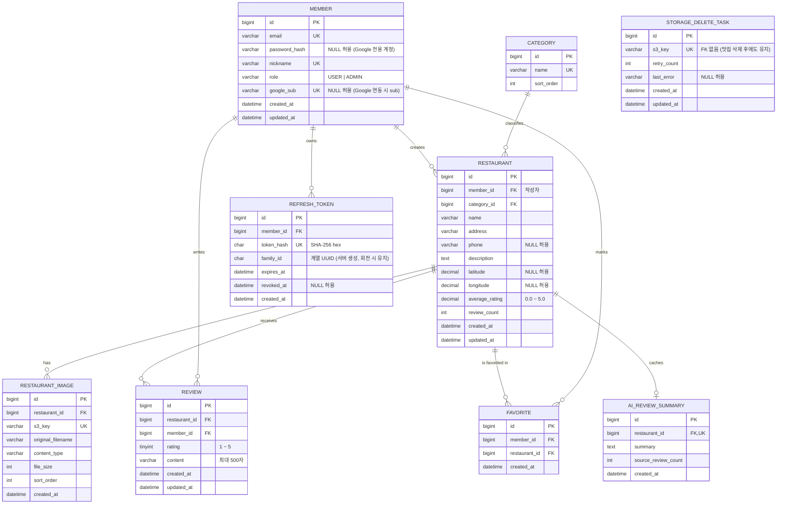

# 데이터베이스 ERD

대상 DBMS: **MySQL 8** (InnoDB, utf8mb4 / utf8mb4_unicode_ci)
운영 위치: **AWS EC2 내부 설치** (RDS 미사용, Q4)

이 문서의 테이블, 컬럼, 제약은 [API_SPEC.md](API_SPEC.md)의 요청·응답 필드 및 [FUNCTION_SPEC.md](FUNCTION_SPEC.md)의 처리 흐름과 일치해야 합니다. 변경할 때는 세 문서를 함께 수정합니다.

## 1. ERD (Mermaid)



> `STORAGE_DELETE_TASK`는 다른 테이블과 FK로 연결하지 않습니다. 맛집이 삭제된 뒤에도 S3 객체 키를 보관해야 하기 때문입니다.

## 2. 테이블 정의

### 2.1 member (회원)

| 컬럼 | 타입 | NULL | 기본값 | 설명 |
|------|------|------|--------|------|
| id | BIGINT | N | AUTO_INCREMENT | PK |
| email | VARCHAR(255) | N | | 로그인 ID, 소문자 저장 |
| password_hash | VARCHAR(100) | Y | | BCrypt 해시. Google 전용 계정은 NULL |
| nickname | VARCHAR(20) | N | | 2~20자. 중복 불가 (`uk_member_nickname`) |
| role | VARCHAR(20) | N | 'USER' | `USER`(일반 회원) 또는 `ADMIN`(관리자) |
| google_sub | VARCHAR(255) | Y | | 연동된 Google 계정의 `sub`. 연동하지 않았으면 NULL |
| created_at | DATETIME(6) | N | CURRENT_TIMESTAMP(6) | |
| updated_at | DATETIME(6) | N | CURRENT_TIMESTAMP(6) ON UPDATE | |

- UNIQUE: `uk_member_email (email)`
- UNIQUE: `uk_member_nickname (nickname)` — 닉네임 중복 방지 (FR-01-01, FR-01-23). 애플리케이션의 사전 중복 검사는 동시 요청을 완전히 막을 수 없으므로, 최종 중복 방어는 이 제약입니다. 저장 시 위반이 발생하면 서비스 계층에서 `NICKNAME_DUPLICATED`(API 409) 또는 화면 `nickname_duplicated`로 변환합니다 (DEVELOPMENT_RULES 6.4). 중복 판정의 대소문자·악센트 구분은 테이블 collation을 따르며, 구현 단계에서 확인합니다.
- UNIQUE: `uk_member_google_sub (google_sub)` — 한 Google 계정은 한 회원에만 연결 (FR-01-11). MySQL UNIQUE는 NULL 중복을 허용하므로 미연동 회원은 여러 명일 수 있습니다.
- CHECK: `ck_member_role` — `role IN ('USER','ADMIN')`
- 로그인 수단 규칙: `password_hash`와 `google_sub` 중 최소 하나는 NOT NULL이어야 합니다 (FR-01-13). 애플리케이션에서 검증하고, 조건을 DB CHECK로도 둡니다: `ck_member_login_method` — `CHECK (password_hash IS NOT NULL OR google_sub IS NOT NULL)`. 이 조건은 `db/manual/001_create_member_refresh_token.sql`과 일치합니다.
- `role`은 일반 회원 API로 변경할 수 없습니다 (FR-09-09). 변경 경로는 T2에서 정합니다.

#### 변경 내역 (Q1, Q5)

| 구분 | 이전 | 현재 | 이유 |
|------|------|------|------|
| 삭제 | `provider` (LOCAL/GOOGLE) | - | 자동 연동을 하지 않고 한 회원이 이메일 로그인과 Google 연동을 함께 가질 수 있으므로 "가입 방식" 단일 값으로는 표현이 맞지 않음 |
| 삭제 | `provider_id` (Google sub) | `google_sub` | 이름을 역할에 맞게 바꾸고, 중복 연결 방지 UNIQUE를 직접 건다 |
| 추가 | - | `role` | 관리자 구분 (Q5). 별도 관리자 테이블은 만들지 않음 |

- 제거된 `uk_member_provider (provider, provider_id)`는 `uk_member_google_sub`로 대체합니다.

### 2.2 category (카테고리)

| 컬럼 | 타입 | NULL | 기본값 | 설명 |
|------|------|------|--------|------|
| id | BIGINT | N | AUTO_INCREMENT | PK |
| name | VARCHAR(30) | N | | 카테고리명 |
| sort_order | INT | N | 0 | 화면 표시 순서 |

- UNIQUE: `uk_category_name (name)`
- 시드 데이터: 한식, 중식, 일식, 양식, 분식, 카페·디저트, 해산물, 고기·구이, 술집, 기타

### 2.3 restaurant (맛집)

| 컬럼 | 타입 | NULL | 기본값 | 설명 |
|------|------|------|--------|------|
| id | BIGINT | N | AUTO_INCREMENT | PK |
| member_id | BIGINT | N | | 작성자 (FK → member.id) |
| category_id | BIGINT | N | | FK → category.id |
| name | VARCHAR(50) | N | | 맛집 이름 |
| address | VARCHAR(200) | N | | 주소 |
| phone | VARCHAR(20) | Y | | 숫자와 하이픈 |
| description | TEXT | N | | 설명, 최대 2000자 (애플리케이션 검증) |
| latitude | DECIMAL(10,7) | Y | | 위도 |
| longitude | DECIMAL(10,7) | Y | | 경도 |
| average_rating | DECIMAL(2,1) | N | 0.0 | 평균 평점 |
| review_count | INT | N | 0 | 리뷰 수 |
| created_at | DATETIME(6) | N | CURRENT_TIMESTAMP(6) | |
| updated_at | DATETIME(6) | N | CURRENT_TIMESTAMP(6) ON UPDATE | |

- FK: `fk_restaurant_member (member_id) → member(id) ON DELETE RESTRICT`
- FK: `fk_restaurant_category (category_id) → category(id) ON DELETE RESTRICT`
- INDEX: `idx_restaurant_category (category_id, created_at)` — 카테고리 목록·최신순
- INDEX: `idx_restaurant_created (created_at)` — 메인 최신 맛집
- INDEX: `idx_restaurant_name (name)` — 이름 검색 보조 (LIKE '%…%'는 풀 스캔이 될 수 있으므로 규모가 커지면 FULLTEXT 검토)
- CHECK: `average_rating BETWEEN 0 AND 5`, `review_count >= 0`

> 권한 규칙 (FR-02-03, FR-09-02): 일반 맛집 수정·삭제 API는 `member_id`가 요청자와 같을 때만 허용합니다. 관리자는 F1-09의 관리자 API로만 다른 회원의 맛집을 수정·삭제합니다.

### 2.4 restaurant_image (맛집 이미지)

| 컬럼 | 타입 | NULL | 기본값 | 설명 |
|------|------|------|--------|------|
| id | BIGINT | N | AUTO_INCREMENT | PK |
| restaurant_id | BIGINT | N | | FK → restaurant.id |
| s3_key | VARCHAR(500) | N | | S3 객체 키 |
| original_filename | VARCHAR(255) | N | | 업로드 원본 파일명 |
| content_type | VARCHAR(50) | N | | `image/jpeg`, `image/png`, `image/webp` |
| file_size | INT | N | | 바이트 단위, 5MB 이하 |
| sort_order | INT | N | 0 | 표시 순서 |
| created_at | DATETIME(6) | N | CURRENT_TIMESTAMP(6) | |

- FK: `fk_image_restaurant (restaurant_id) → restaurant(id) ON DELETE CASCADE`
- UNIQUE: `uk_image_s3_key (s3_key)`
- INDEX: `idx_image_restaurant (restaurant_id, sort_order)`
- 삭제 규칙: 이 행을 삭제할 때는 같은 트랜잭션에서 `storage_delete_task`에 `s3_key`를 기록합니다. S3 객체 삭제는 커밋 후 수행합니다 (FUNCTION_SPEC F1-03).

### 2.5 review (리뷰)

| 컬럼 | 타입 | NULL | 기본값 | 설명 |
|------|------|------|--------|------|
| id | BIGINT | N | AUTO_INCREMENT | PK |
| restaurant_id | BIGINT | N | | FK → restaurant.id |
| member_id | BIGINT | N | | FK → member.id |
| rating | TINYINT | N | | 1~5 정수 |
| content | VARCHAR(500) | N | | 리뷰 내용 |
| created_at | DATETIME(6) | N | CURRENT_TIMESTAMP(6) | |
| updated_at | DATETIME(6) | N | CURRENT_TIMESTAMP(6) ON UPDATE | |

- FK: `fk_review_restaurant (restaurant_id) → restaurant(id) ON DELETE CASCADE`
- FK: `fk_review_member (member_id) → member(id) ON DELETE CASCADE`
- UNIQUE: `uk_review_member_restaurant (restaurant_id, member_id)` — 한 회원당 맛집 리뷰 1개 (FR-04-02)
- INDEX: `idx_review_restaurant_created (restaurant_id, created_at)`
- CHECK: `rating BETWEEN 1 AND 5`

> 삭제 권한 (FR-04-03): 회원 삭제 API는 리뷰 작성자 본인만 허용합니다. 관리자 삭제는 F1-09에서 별도 API로 제공합니다.

### 2.6 favorite (찜)

| 컬럼 | 타입 | NULL | 기본값 | 설명 |
|------|------|------|--------|------|
| id | BIGINT | N | AUTO_INCREMENT | PK |
| member_id | BIGINT | N | | FK → member.id |
| restaurant_id | BIGINT | N | | FK → restaurant.id |
| created_at | DATETIME(6) | N | CURRENT_TIMESTAMP(6) | |

- FK: `fk_favorite_member (member_id) → member(id) ON DELETE CASCADE`
- FK: `fk_favorite_restaurant (restaurant_id) → restaurant(id) ON DELETE CASCADE`
- UNIQUE: `uk_favorite_member_restaurant (member_id, restaurant_id)` — 중복 찜 방지 (FR-06-02)
- INDEX: `idx_favorite_member_created (member_id, created_at)` — 내 찜 목록

### 2.7 ai_review_summary (AI 리뷰 요약 캐시)

| 컬럼 | 타입 | NULL | 기본값 | 설명 |
|------|------|------|--------|------|
| id | BIGINT | N | AUTO_INCREMENT | PK |
| restaurant_id | BIGINT | N | | FK → restaurant.id, 맛집당 1행 |
| summary | TEXT | N | | AI 생성 요약 |
| source_review_count | INT | N | | 요약 생성 시점의 리뷰 수 |
| created_at | DATETIME(6) | N | CURRENT_TIMESTAMP(6) | 생성 시각 |

- FK: `fk_summary_restaurant (restaurant_id) → restaurant(id) ON DELETE CASCADE`
- UNIQUE: `uk_summary_restaurant (restaurant_id)`
- 무효화: 리뷰 작성·삭제(회원 삭제, 관리자 삭제 포함) 시 해당 행 DELETE (FUNCTION_SPEC F1-05)

### 2.8 refresh_token (리프레시 토큰)

| 컬럼 | 타입 | NULL | 기본값 | 설명 |
|------|------|------|--------|------|
| id | BIGINT | N | AUTO_INCREMENT | PK |
| member_id | BIGINT | N | | FK → member.id |
| token_hash | CHAR(64) | N | | Refresh Token의 SHA-256 해시 (원문 저장 금지) |
| family_id | CHAR(36) (구현 전 검토) | N | | 토큰 계열 식별 UUID (가명 식별자). 서버가 생성한다. 직접 식별 정보는 없지만 회원 및 인증 세션과 연결될 수 있으므로 외부 노출을 막는다. 같은 로그인 세션의 회전에서는 같은 값을 유지하고, 새 기기 로그인에서는 새로 생성한다 (FR-01-36) |
| expires_at | DATETIME(6) | N | | 만료 시각 |
| revoked_at | DATETIME(6) | Y | | 로그아웃·재발급 등으로 폐기된 시각 |
| created_at | DATETIME(6) | N | CURRENT_TIMESTAMP(6) | |

- FK: `fk_refresh_member (member_id) → member(id) ON DELETE CASCADE`
- UNIQUE: `uk_refresh_token_hash (token_hash)`
- INDEX: `idx_refresh_member (member_id, revoked_at)`
- INDEX (설계안): `idx_refresh_family (family_id)`. 계열 단위 요청 제한 조회용. 구현 전 검토 대상이다.
- 계열(`family_id`): 회전할 때 기존 행의 값을 새 행에 그대로 복사한다. 새 기기 로그인은 새 UUID를 만든다. `family_id`는 서버가 생성하는 UUID다. 직접적인 개인 식별 정보는 포함하지 않지만, 회원 및 인증 세션과 연결될 수 있는 가명 식별자다. 따라서 개인정보 및 보안 정보에 준하여 접근을 통제하고 로그를 관리하며, 원본 Refresh Token과 마찬가지로 외부 노출을 막는다. 요청 제한의 키로도 쓴다 (API_SPEC 1.4). 기존 계열 구조와 T7·T14 정책은 바뀌지 않는다.
- 원문 저장 위치: 브라우저의 HttpOnly Cookie만 (FR-01-05). DB에는 해시만 저장합니다.
- 로테이션 (FR-01-06): 재발급 시 기존 행의 `revoked_at`을 기록하고 새 행을 INSERT합니다. 행을 물리 삭제하지 않습니다. 만료되거나 폐기된 행을 정리하는 방식은 구현 단계에서 정합니다.
- 재사용 탐지 (T7 A안 확정): 폐기된 Refresh Token의 재사용이 실제로 탐지되면 해당 회원의 모든 활성 Refresh Token(`revoked_at IS NULL`)을 폐기합니다. 원문은 저장하지 않고 SHA-256 해시만 저장합니다. 폐기된 행은 재사용 탐지를 위해 보존합니다.
- 동시 갱신 (T14 A안 확정): 재발급과 재사용 탐지는 회원 행 잠금 안에서 같은 순서로 처리합니다 (DEVELOPMENT_RULES 5.7.4). 여러 탭의 갱신은 브라우저의 Web Locks API로 조정합니다. 이 결정은 테이블 구조를 바꾸지 않으며, 유예 창이나 새 컬럼을 추가하지 않습니다.
- 네트워크 응답 유실로 인한 정상 사용자의 재로그인은 A안의 수용된 한계입니다.

### 2.9 storage_delete_task (S3 삭제 추적) — 신규

| 컬럼 | 타입 | NULL | 기본값 | 설명 |
|------|------|------|--------|------|
| id | BIGINT | N | AUTO_INCREMENT | PK |
| s3_key | VARCHAR(500) | N | | 삭제해야 할 S3 객체 키 |
| retry_count | INT | N | 0 | S3 삭제 시도 실패 횟수 |
| last_error | VARCHAR(500) | Y | | 마지막 실패 메시지 (비밀 정보 제외) |
| created_at | DATETIME(6) | N | CURRENT_TIMESTAMP(6) | 삭제 대기 등록 시각 |
| updated_at | DATETIME(6) | N | CURRENT_TIMESTAMP(6) ON UPDATE | 마지막 시도 시각 |

- UNIQUE: `uk_storage_task_s3_key (s3_key)`
- INDEX: `idx_storage_task_created (created_at)` — 관리자 목록 정렬
- 행의 의미: "DB에서는 이미 삭제되었지만 S3 객체는 아직 지워지지 않은 키". S3 삭제에 성공하면 행을 삭제합니다.
- 생성 규칙: 맛집 삭제·이미지 삭제 트랜잭션 안에서 INSERT합니다. 이렇게 하면 DB 커밋 후 프로세스가 중단되어도 키가 남습니다.
- 재시도: 관리자 API로 수동 재시도합니다 (FR-03-06, FR-09-06). 자동 재시도 여부는 T6에서 정합니다.

#### 추가 이유

S3 삭제 실패 키를 추적하고 재시도하려면 영속 기록이 필요합니다. 기존 테이블 중에는 삭제가 끝난 `restaurant_image` 행을 이 용도로 쓸 수 없고(행이 이미 사라짐), 맛집이 삭제되면 같이 사라지는 테이블도 적합하지 않습니다. 따라서 Q2 구현에 필요한 최소 테이블 1개만 추가합니다.

### 2.10 요청 제한 이벤트와 카운터 (설계안)

요청 제한(API_SPEC 1.4, FR-01-28~FR-01-35)을 위해 다음 테이블을 설계안으로 둡니다. 개인정보는 최소로 보관합니다. 정확한 컬럼 타입, 길이, 제약 이름, 인덱스 이름은 구현 전에 별도로 검토합니다. 아래 표의 타입 표기는 방향만 나타냅니다.

| 테이블 | 역할 | 저장 정보 (최소) | 관계 | 인덱스 요구 |
|--------|------|------------------|------|-------------|
| `login_failure_event` | 로그인 실패 이벤트. 요청마다 1행 | `pair_key_hash`: 정규화 이메일+IP의 HMAC-SHA256 (확정), `ip_key`: IP 키 (T16 결정에 따름), `failed_at` | 독립. FK 없음 | (`pair_key_hash`, `failed_at`), (`ip_key`, `failed_at`), (`failed_at`) 정리용 |
| `signup_request_event` | 회원가입 요청 이벤트. 화면, API, Google 신규 가입 닉네임 제출 공통 | `ip_key` (T16), `requested_at` | 독립 | (`ip_key`, `requested_at`), (`requested_at`) |
| `refresh_request_event` | Refresh 요청 이벤트. 계열을 확인할 수 있는 요청만 기록 | `family_id`, `requested_at` | `refresh_token.family_id`를 논리적으로 참조. FK 없음 | (`family_id`, `requested_at`), (`requested_at`) |
| `google_oauth_request_event` | Google OAuth2 시작·콜백 및 계정 연동 콜백 이벤트 | `ip_key` (T16), `requested_at` | 독립 | (`ip_key`, `requested_at`), (`requested_at`) |
| `auth_rate_limit_counter` | 같은 키의 동시 요청을 직렬화하는 잠금 행 | `counter_key` (키 종류와 값의 해시), `updated_at` | 이벤트 테이블과 키 값으로 연결. FK 없음 | PK (`counter_key`) |

- 제한 판단의 원천은 이벤트 테이블입니다. `auth_rate_limit_counter`는 같은 키의 요청을 한 번에 하나씩 처리하도록 잠그는 행입니다.
- 로그인 이벤트 테이블에는 원문 이메일과 원문 IP를 저장하지 않습니다 (확정, R2). 회원가입과 Google 제한의 IP 키 저장 형식은 T16 결정 전까지 확정하지 않습니다 (권장: HMAC-SHA256).
- HMAC 키를 교체하면 기존 키로 만든 `pair_key_hash`와 IP 키는 새 키로 조회되지 않습니다. 교체 전 정리 절차는 DEVELOPMENT_RULES 5.8을 따릅니다. Refresh 계열 키(`family_id`)는 HMAC을 쓰지 않으므로 영향을 받지 않습니다.
- 보존 기간: 로그인, 회원가입, Refresh 이벤트는 24시간 보관 후 삭제합니다 (확정, R3). Google OAuth2 이벤트의 24시간 보존은 권장안입니다 (T18).
- 조회 범위(15분, 1시간, 1분)를 벗어났다는 이유만으로 이벤트를 즉시 삭제하지 않습니다. 삭제는 보존 기간 기준으로만 합니다.
- 정리 방식: 요청 시 정리와 Spring Scheduling 기반 주기적 정리를 병행합니다. 요청 시 정리는 인덱스를 사용하고 한 번에 삭제하는 행 수를 제한합니다.

동시성 제어 (설계안, R3):
1. 단순 `SELECT COUNT(*)` 후 `INSERT`로 제한을 구현하지 않습니다.
2. 판단에 쓸 키를 계산합니다. 한 요청이 여러 키를 잠글 때(로그인: 이메일+IP 키와 IP 보조 키)는 `counter_key`의 사전순으로 정렬하여 같은 순서로 잠급니다. 교착 상태를 피하기 위해서입니다.
3. 카운터 행이 없으면 `INSERT ... ON DUPLICATE KEY UPDATE`처럼 중복을 허용하지 않는 방식으로 만듭니다. 동시에 생성해도 행은 하나만 남습니다.
4. 같은 트랜잭션에서 `SELECT ... FOR UPDATE`로 카운터 행을 잠급니다.
5. 잠근 상태에서 기간 안의 이벤트 수를 셉니다.
6. 한도 미만이면 이벤트 한 건을 기록하고 커밋합니다. 한도에 도달했으면 이벤트를 기록하지 않고 `429`를 반환합니다.

## 3. 관계 요약

| 관계 | 카디널리티 | 삭제 정책 |
|------|-----------|-----------|
| member → restaurant | 1 : N | 회원 삭제는 제한 (RESTRICT). 탈퇴 정책은 T1 |
| category → restaurant | 1 : N | 사용 중인 카테고리 삭제 제한 (RESTRICT) |
| restaurant → restaurant_image | 1 : N | CASCADE. S3 객체는 `storage_delete_task`를 거쳐 애플리케이션이 삭제 |
| restaurant → review | 1 : N | CASCADE |
| member → review | 1 : N | CASCADE |
| restaurant ↔ member (favorite) | N : M | CASCADE |
| restaurant → ai_review_summary | 1 : 0..1 | CASCADE |
| member → refresh_token | 1 : N | CASCADE |
| storage_delete_task | 독립 | FK 없음. 맛집 삭제 후에도 유지 |

## 4. 데이터 정리 규칙

### 4.1 맛집 삭제 시 데이터 정리 (Q2)

DB 내부 정리는 한 트랜잭션에서 수행하고, S3 삭제는 커밋 후에 수행합니다.

```
[DB 트랜잭션]
  1. restaurant 조회 (없으면 404), restaurant_image의 s3_key 목록 조회
  2. storage_delete_task에 각 s3_key INSERT
  3. ai_review_summary DELETE (restaurant_id)
  4. favorite DELETE (restaurant_id)
  5. review DELETE (restaurant_id)
  6. restaurant_image DELETE (restaurant_id)
  7. restaurant DELETE (id)
  COMMIT
[커밋 후, DB 트랜잭션 밖]
  8. 각 s3_key에 대해 S3 객체 삭제
     - 성공: storage_delete_task 행 DELETE
     - 실패: storage_delete_task.retry_count + 1, last_error 기록
```

- 2번 단계로 DB 행과 S3 키가 같은 커밋에 묶입니다. 3~7번 단계의 FK CASCADE는 안전장치로 함께 둡니다.
- 8번 단계가 실패해도 맛집 삭제는 이미 커밋되었으므로 되돌리지 않습니다.
- 이 흐름은 두 저장소의 원자성을 보장하지 않습니다. 실패는 `storage_delete_task`로 추적·재시도합니다.

### 4.2 집계 값 관리

- `restaurant.review_count`와 `restaurant.average_rating`은 리뷰 작성·삭제 트랜잭션 안에서 갱신합니다.
- 갱신 방식: `UPDATE restaurant SET review_count = review_count + 1, average_rating = ... WHERE id = ?` 또는 재계산 쿼리. 구현 시 동시성 테스트를 작성합니다.
- 평균 평점은 `ROUND(AVG(rating), 1)`과 같은 규칙(소수점 첫째 자리 반올림)을 따릅니다.

## 5. 관리자 기능의 데이터 구조

- 관리자 전용 테이블은 두지 않습니다. 관리자 여부는 `member.role = 'ADMIN'`으로 판단합니다 (FR-09-01).
- 관리자 화면의 목록과 집계(대시보드)는 기존 테이블에 대한 조회 쿼리로 구현합니다.
  - 회원 수: `member`
  - 맛집 수, 최근 7일 신규 맛집: `restaurant`
  - 리뷰 수, 최근 7일 신규 리뷰: `review`
  - S3 삭제 재시도 대기 수: `storage_delete_task`
- 회원 권한 변경 경로는 이번 ERD에 포함하지 않습니다. 정책은 T2에서 정합니다.

## 6. 마이그레이션 규칙

- 스키마 변경은 `db/manual/` 아래 번호가 붙은 SQL 파일로 관리하며, 사람이 대상 DB에 직접 실행합니다. Flyway 등 마이그레이션 도구는 사용하지 않습니다 (REQUIREMENTS 3). 도구 도입은 설계 변경 절차로만 정합니다.
- 한 번 적용된 SQL 파일은 수정하지 않습니다. 새 변경은 다음 번호의 파일로 추가합니다. `ddl-auto`는 `none`을 유지합니다.
- 이번 변경(`member` 컬럼 교체, `storage_delete_task` 추가)은 아직 배포된 DB가 없으므로 초기 스키마에 직접 반영합니다.
