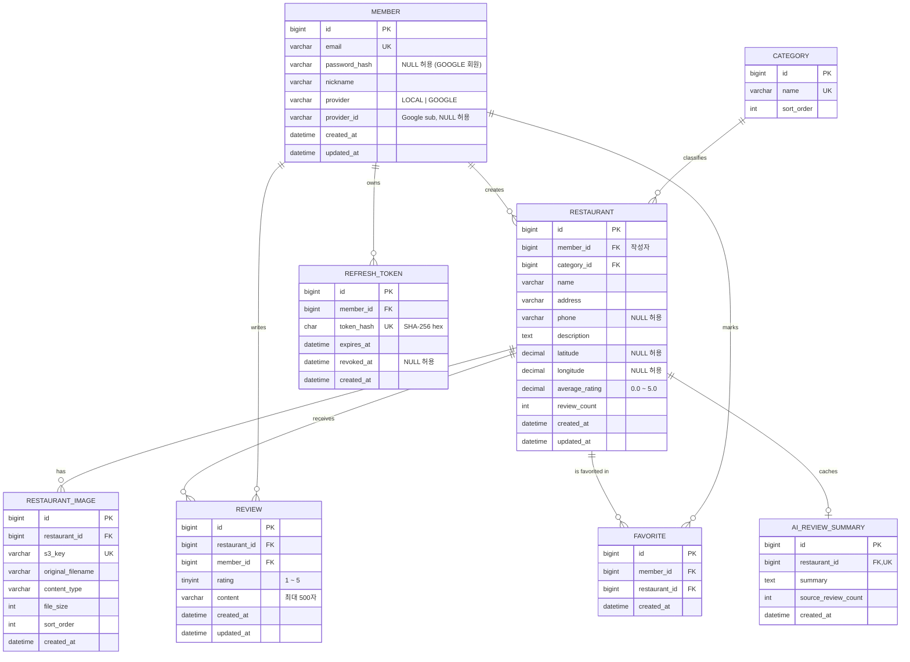

# 데이터베이스 ERD

대상 DBMS: **MySQL 8** (InnoDB, utf8mb4 / utf8mb4_unicode_ci)

이 문서의 테이블, 컬럼, 제약은 [API_SPEC.md](API_SPEC.md)의 요청·응답 필드 및 [FUNCTION_SPEC.md](FUNCTION_SPEC.md)의 처리 흐름과 일치해야 합니다. 변경할 때는 세 문서를 함께 수정합니다.

## 1. ERD (Mermaid)

## 2. 테이블 정의

### 2.1 member (회원)

| 컬럼 | 타입 | NULL | 기본값 | 설명 |
|------|------|------|--------|------|
| id | BIGINT | N | AUTO_INCREMENT | PK |
| email | VARCHAR(255) | N | | 로그인 ID, 소문자 저장 |
| password_hash | VARCHAR(100) | Y | | BCrypt 해시. GOOGLE 회원은 NULL |
| nickname | VARCHAR(20) | N | | 2~20자 |
| provider | VARCHAR(20) | N | 'LOCAL' | `LOCAL` 또는 `GOOGLE` |
| provider_id | VARCHAR(255) | Y | | Google `sub` |
| created_at | DATETIME(6) | N | CURRENT_TIMESTAMP(6) | |
| updated_at | DATETIME(6) | N | CURRENT_TIMESTAMP(6) ON UPDATE | |

- UNIQUE: `uk_member_email (email)`
- UNIQUE: `uk_member_provider (provider, provider_id)` — provider_id가 NULL인 행은 중복 허용 (MySQL 동작)
- CHECK: `provider IN ('LOCAL','GOOGLE')`

### 2.2 category (카테고리)

| 컬럼 | 타입 | NULL | 기본값 | 설명 |
|------|------|------|--------|------|
| id | BIGINT | N | AUTO_INCREMENT | PK |
| name | VARCHAR(30) | N | | 카테고리명 |
| sort_order | INT | N | 0 | 화면 표시 순서 |

- UNIQUE: `uk_category_name (name)`
- 시드 데이터: 한식, 중식, 일식, 양식, 분식, 카페·디저트, 해산물, 고기·구이, 술집, 기타

### 2.3 restaurant (맛집)

| 컬럼 | 타입 | NULL | 기본값 | 설명 |
|------|------|------|--------|------|
| id | BIGINT | N | AUTO_INCREMENT | PK |
| member_id | BIGINT | N | | 작성자 (FK → member.id) |
| category_id | BIGINT | N | | FK → category.id |
| name | VARCHAR(50) | N | | 맛집 이름 |
| address | VARCHAR(200) | N | | 주소 |
| phone | VARCHAR(20) | Y | | 숫자와 하이픈 |
| description | TEXT | N | | 설명, 최대 2000자 (애플리케이션 검증) |
| latitude | DECIMAL(10,7) | Y | | 위도 |
| longitude | DECIMAL(10,7) | Y | | 경도 |
| average_rating | DECIMAL(2,1) | N | 0.0 | 평균 평점 |
| review_count | INT | N | 0 | 리뷰 수 |
| created_at | DATETIME(6) | N | CURRENT_TIMESTAMP(6) | |
| updated_at | DATETIME(6) | N | CURRENT_TIMESTAMP(6) ON UPDATE | |

- FK: `fk_restaurant_member (member_id) → member(id) ON DELETE RESTRICT`
- FK: `fk_restaurant_category (category_id) → category(id) ON DELETE RESTRICT`
- INDEX: `idx_restaurant_category (category_id, created_at)` — 카테고리 목록·최신순
- INDEX: `idx_restaurant_created (created_at)` — 메인 최신 맛집
- INDEX: `idx_restaurant_name (name)` — 이름 검색 보조 (LIKE '%…%'는 풀 스캔이 될 수 있으므로 규모가 커지면 FULLTEXT 검토)
- CHECK: `average_rating BETWEEN 0 AND 5`, `review_count >= 0`

> 정책 Q5: 맛집 수정·삭제는 `member_id`가 요청자와 같을 때만 허용합니다.

### 2.4 restaurant_image (맛집 이미지)

| 컬럼 | 타입 | NULL | 기본값 | 설명 |
|------|------|------|--------|------|
| id | BIGINT | N | AUTO_INCREMENT | PK |
| restaurant_id | BIGINT | N | | FK → restaurant.id |
| s3_key | VARCHAR(500) | N | | S3 객체 키 |
| original_filename | VARCHAR(255) | N | | 업로드 원본 파일명 |
| content_type | VARCHAR(50) | N | | `image/jpeg`, `image/png`, `image/webp` |
| file_size | INT | N | | 바이트 단위, 5MB 이하 |
| sort_order | INT | N | 0 | 표시 순서 |
| created_at | DATETIME(6) | N | CURRENT_TIMESTAMP(6) | |

- FK: `fk_image_restaurant (restaurant_id) → restaurant(id) ON DELETE CASCADE`
- UNIQUE: `uk_image_s3_key (s3_key)`
- INDEX: `idx_image_restaurant (restaurant_id, sort_order)`

### 2.5 review (리뷰)

| 컬럼 | 타입 | NULL | 기본값 | 설명 |
|------|------|------|--------|------|
| id | BIGINT | N | AUTO_INCREMENT | PK |
| restaurant_id | BIGINT | N | | FK → restaurant.id |
| member_id | BIGINT | N | | FK → member.id |
| rating | TINYINT | N | | 1~5 정수 |
| content | VARCHAR(500) | N | | 리뷰 내용 |
| created_at | DATETIME(6) | N | CURRENT_TIMESTAMP(6) | |
| updated_at | DATETIME(6) | N | CURRENT_TIMESTAMP(6) ON UPDATE | |

- FK: `fk_review_restaurant (restaurant_id) → restaurant(id) ON DELETE CASCADE`
- FK: `fk_review_member (member_id) → member(id) ON DELETE CASCADE`
- UNIQUE: `uk_review_member_restaurant (restaurant_id, member_id)` — 한 회원당 맛집 리뷰 1개 (FR-04-02)
- INDEX: `idx_review_restaurant_created (restaurant_id, created_at)`
- CHECK: `rating BETWEEN 1 AND 5`

### 2.6 favorite (찜)

| 컬럼 | 타입 | NULL | 기본값 | 설명 |
|------|------|------|--------|------|
| id | BIGINT | N | AUTO_INCREMENT | PK |
| member_id | BIGINT | N | | FK → member.id |
| restaurant_id | BIGINT | N | | FK → restaurant.id |
| created_at | DATETIME(6) | N | CURRENT_TIMESTAMP(6) | |

- FK: `fk_favorite_member (member_id) → member(id) ON DELETE CASCADE`
- FK: `fk_favorite_restaurant (restaurant_id) → restaurant(id) ON DELETE CASCADE`
- UNIQUE: `uk_favorite_member_restaurant (member_id, restaurant_id)` — 중복 찜 방지 (FR-06-02)
- INDEX: `idx_favorite_member_created (member_id, created_at)` — 내 찜 목록

### 2.7 ai_review_summary (AI 리뷰 요약 캐시)

| 컬럼 | 타입 | NULL | 기본값 | 설명 |
|------|------|------|--------|------|
| id | BIGINT | N | AUTO_INCREMENT | PK |
| restaurant_id | BIGINT | N | | FK → restaurant.id, 맛집당 1행 |
| summary | TEXT | N | | AI 생성 요약 |
| source_review_count | INT | N | | 요약 생성 시점의 리뷰 수 |
| created_at | DATETIME(6) | N | CURRENT_TIMESTAMP(6) | 생성 시각 |

- FK: `fk_summary_restaurant (restaurant_id) → restaurant(id) ON DELETE CASCADE`
- UNIQUE: `uk_summary_restaurant (restaurant_id)`
- 무효화: 리뷰 작성·삭제 시 해당 행 DELETE (FUNCTION_SPEC F1-05)

### 2.8 refresh_token (리프레시 토큰)

| 컬럼 | 타입 | NULL | 기본값 | 설명 |
|------|------|------|--------|------|
| id | BIGINT | N | AUTO_INCREMENT | PK |
| member_id | BIGINT | N | | FK → member.id |
| token_hash | CHAR(64) | N | | 토큰의 SHA-256 해시 (원문 저장 금지) |
| expires_at | DATETIME(6) | N | | 만료 시각 |
| revoked_at | DATETIME(6) | Y | | 로그아웃 등으로 폐기된 시각 |
| created_at | DATETIME(6) | N | CURRENT_TIMESTAMP(6) | |

- FK: `fk_refresh_member (member_id) → member(id) ON DELETE CASCADE`
- UNIQUE: `uk_refresh_token_hash (token_hash)`
- INDEX: `idx_refresh_member (member_id, revoked_at)`

## 3. 관계 요약

| 관계 | 카디널리티 | 삭제 정책 |
|------|-----------|-----------|
| member → restaurant | 1 : N | 회원 삭제는 제한 (RESTRICT) |
| category → restaurant | 1 : N | 사용 중인 카테고리 삭제 제한 (RESTRICT) |
| restaurant → restaurant_image | 1 : N | CASCADE (S3 객체는 애플리케이션에서 함께 삭제) |
| restaurant → review | 1 : N | CASCADE |
| member → review | 1 : N | CASCADE |
| restaurant ↔ member (favorite) | N : M | CASCADE |
| restaurant → ai_review_summary | 1 : 0..1 | CASCADE |
| member → refresh_token | 1 : N | CASCADE |

## 4. 집계 값 관리 규칙

- `restaurant.review_count`와 `restaurant.average_rating`은 리뷰 작성·삭제 트랜잭션 안에서 갱신합니다.
- 갱신 방식: `UPDATE restaurant SET review_count = review_count + 1, average_rating = ... WHERE id = ?` 또는 재계산 쿼리. 구현 시 동시성 테스트를 작성합니다.
- 평균 평점은 `ROUND(AVG(rating), 1)`과 같은 규칙(소수점 첫째 자리 반올림)을 따릅니다.

## 5. 마이그레이션 규칙

- 스키마 변경은 Flyway 마이그레이션 스크립트(`V{번호}__{설명}.sql`)로 관리합니다. Flyway 도입은 설계 변경 절차를 거쳐 확정합니다 (현재는 미결정).
- 한 번 배포된 마이그레이션 파일은 수정하지 않습니다.
